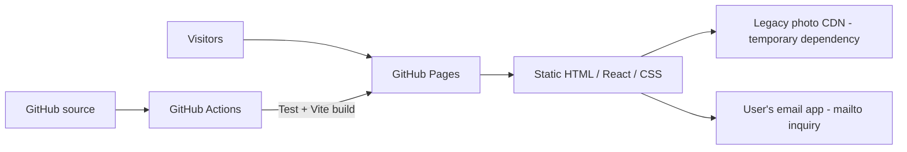

# Custom Design Windows

Responsive static website starter for **Custom Design Windows**, a Fort Lauderdale custom window-treatment studio established in 1984. Recreates the **structure and key business information** of [customdesignwindows.com](https://www.customdesignwindows.com/) with a new React/Vite design.

**Preview target:** https://bare-systems.github.io/custom-design-windows/ (requires GitHub Pages to be enabled in repository Settings).  
**Original production site:** https://www.customdesignwindows.com/ — **do not redirect this domain yet**.

## What's included

- Seven matching page routes: `/`, `/about`, `/window-treatments`, `/gallery`, `/reviews`, `/custom-window-treatments-faq-fort-lauderdale-`, `/contact`.
- Existing business details, services, founder history, consultation offer, and the core FAQ topics.
- Ten **real photos linked from the original site's gallery**, with category filtering and responsive images. The full original gallery contains more; migration is incomplete.
- Mobile navigation, phone/email links, page-specific titles/descriptions, semantic HTML, and responsive layouts.
- Client-side contact form that **opens the visitor's email application**. It does not send messages itself; there is no backend or data storage.
- Deliberately **no fabricated testimonials**. The Reviews page links to the existing site until verified quotes can be migrated.

### Pages

| Route | Content |
| --- | --- |
| `/` | Hero, service overview, gallery preview, introduction, consultation CTA |
| `/about` | Dale Ellen Iarossi, WFCP; business history and approach |
| `/window-treatments` | Draperies, shades/blinds, top treatments, accessories, commercial work |
| `/gallery` | Selected photos from the legacy website (filterable) |
| `/reviews` | Verified-review migration placeholder, legacy-site link |
| `/custom-window-treatments-faq-fort-lauderdale-` | Answers to core questions from the legacy FAQ |
| `/contact` | Phone, email, office information, email-compose inquiry form |

## Architecture



No API, database, or Cloudflare configuration is required for this initial website. The existing domain and its email hosting are **not** modified.

## Development

Requires Node.js 22+:

```bash
npm install
npm run dev
npm test
npm run build
npm run preview
```

Vite compiles **multiple real HTML entries**, rather than relying on history-fallback SPA routing. The seven existing paths resolve directly on GitHub Pages, including on refresh.

For the repository Pages project URL, the base path defaults to `/custom-design-windows/`. To build for the custom domain root later:

```bash
SITE_BASE=/ npm run build
```

Update the GitHub Actions repository **variable** `SITE_BASE` to `/` when ready to deploy to `customdesignwindows.com`.

## GitHub Pages deployment

Workflow: [`.github/workflows/pages.yml`](.github/workflows/pages.yml)

1. Repository **Settings → Pages → Build and deployment → Source → GitHub Actions**.
2. Push to `main` (or run **Actions → Build and deploy website → Run workflow**).
3. The workflow installs packages under Node 22, runs tests, builds all HTML entries to `dist/`, and deploys the resulting artifact.

**No GitHub secrets are required.** `SITE_BASE` is optional for preview (defaults to `/custom-design-windows/`). Nothing in this workflow touches the production DNS.

To build locally without CI, run `npm install && npm test && npm run build`. A manual GitHub Pages deployment can use a `gh-pages` branch (e.g. `npx --yes gh-pages -d dist -b gh-pages`) after changing Pages **Source** to **Deploy from a branch** and selecting `gh-pages` root. Switch back to **GitHub Actions** to restore the workflow.

## Production cutover checklist

**Do not cut over yet.** Before moving the existing domain:

1. **Export and self-host all original portfolio images.** The starter currently hotlinks ten originals from `lirp.cdn-website.com`; shutting down the former site/media service could break them. Put owned files under `public/images/` and update `src/data.js`. The legacy gallery contains more photographs to migrate.
2. Retrieve and verify original testimonials; replace the Reviews placeholder and legacy-site link.
3. Decide whether to implement a real server-backed contact form (e.g. Cloudflare Worker + email provider) or keep the email-compose behavior. The current form **does not submit** to a server.
4. Confirm service descriptions, business contact/address, and any legal/privacy information with the business owner.
5. Switch `SITE_BASE=/`, add an appropriate `public/CNAME`, configure GitHub Pages **Custom domain**, then update DNS as directed by GitHub. Do not change MX/email DNS records when migrating web hosting.
6. Remove preview-only `noindex,nofollow` meta tags from the seven HTML files and replace `public/robots.txt` with a production crawl policy. Add the canonical production URL / sitemap when ready. Consider redirects from old URL variations.

## Structure

```text
index.html                         Home
about/index.html                   One real HTML entry per route
window-treatments/index.html
gallery/index.html
reviews/index.html
custom-window-treatments-faq-fort-lauderdale-/index.html
contact/index.html
src/main.jsx                       React components / contact email composer
src/data.js                        Business information, gallery images, services, FAQs
src/styles.css                     Responsive design system
public/favicon.svg                 Original site icon
vite.config.js                     Multi-page build / SITE_BASE
tests/site.test.js                 Content and routing checks
.github/workflows/pages.yml        CI/CD
```

Original website content and media were used as references for this family-owned replacement. Verify image ownership and vendor licensing before production.
